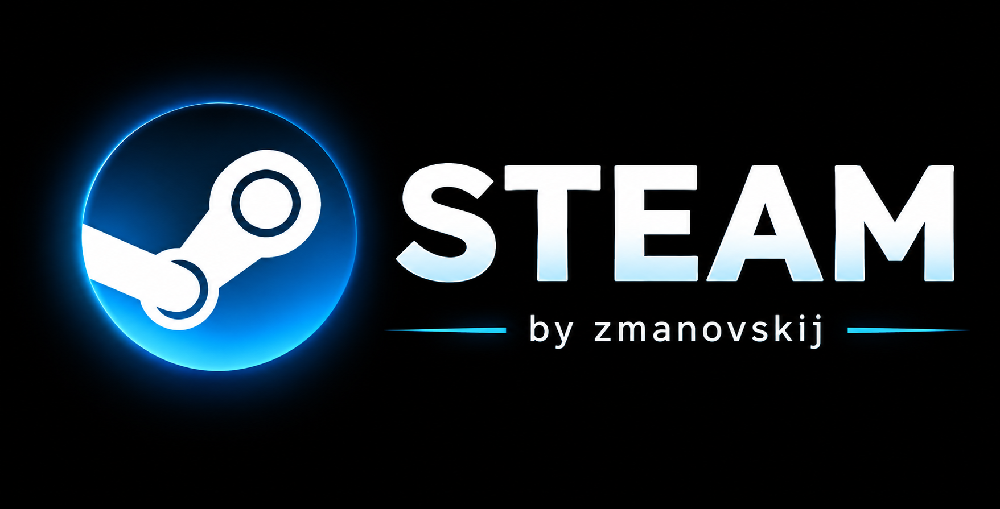

# Steam Next-Gen Platform • by zmanovskij



Современная игровая платформа цифровой дистрибуции на базе **C++20 Core** и ультра-чистого интерфейса **Microsoft Edge WebView2** с эстетикой *Unslop UI* и неоновым брендингом **Steam by zmanovskij**.

---

## 🌟 Ключевые возможности

1. **Современный Web UI на Microsoft Edge WebView2**:
   - Аппаратное ускорение графики через Chromium и нативный C++ Windows Shell (`HWND`).
   - Темная тема OLED / Slate (`#080A0E`, `#0E1218`, `#141822`) с акцентом `#00A3FF`.
   - Вложенные скругления по дизайн-системе (16px / 12px / 8px / 4px), шрифты Inter и чистый микроинтерфейс без визуального мусора.

2. **Строгая навигация: 2 главные вкладки**:
   - **Магазин (Store)**: Hero-баннер с новинками, динамическая фильтрация категорий (FPS, Гонки, RPG), быстрый поиск, модальное окно деталей игры со скриншотами и системными требованиями.
   - **Библиотека (Library)**: Сайдбар со списком добавленных игр, карточка выбранной игры с фоновым артом, кнопка **«Установить»** с анимированным прогресс-баром и скоростью загрузки, кнопка **«ИГРАТЬ»** со статусом реального запущенного процесса.

3. **Динамический каталог из облака GitHub**:
   - Автоматическая загрузка каталога игр из GitHub-репозитория: `https://raw.githubusercontent.com/oskarlolpocursor3/Steam-Platform/main/catalog/games.json`.
   - Поддержка офлайн-фоллбека при отсутствии интернета.

4. **Локальный профиль пользователя**:
   - Клик по аватарке в шапке открывает персональный профиль игрока.
   - Смена никнейма и мгновенное сохранение в `localStorage` и C++ сессию.
   - Выбор аватара из готовых пресетов или **загрузка любого изображения с локального диска** (Base64).

5. **Реальная установка и запуск игр**:
   - **Counter-Strike 2 (3D FPS Demake)**: тактический софтверный 3D FPS на C# с DDA трассировкой лучей, картой Dust 2, вертикальным обзором (Pitch/Yaw), прыжками и присядкой.
   - **Super Mario Kart C# (60 FPS Edition)**: псевдо-3D аркадные гонки на C# с аппаратным алгоритмом Mode 7.
   - **Dungeons & Dragons: Console RPG**: пошаговая текстовая RPG по правилам D&D 5e.

---

## 🏗 Архитектура

```
steam/
├── CMakeLists.txt                      # Сборка C++20 с интеграцией WebView2 SDK
├── build.bat / run.bat                 # Быстрая компиляция и запуск в 1 клик
├── src/
│   ├── core/                           # UserSession, AppManifest, Types, Sha256
│   ├── downloader/                     # DownloadManager (диапазоны, чанки)
│   ├── launcher/                       # ProcessLauncher (Windows CreateProcessW, отслеживание PID)
│   ├── storage/                        # JsonStorage (атомарное локальное сохранение)
│   ├── ui/                             # C++ WebView2 хостинг и двусторонний IPC Bridge
│   └── main.cpp                        # Главная точка входа
├── ui_web/                             # Современный фронтенд интерфейса
│   ├── index.html                      # Разметка: Магазин, Библиотека, Профиль
│   ├── style.css                       # Дизайн-система Graphite/Slate, неон, акцент #00A3FF
│   ├── app.js                          # Логика клиента, загрузка с GitHub, IPC мост
│   └── assets/logo.png                 # Неоновый логотип Steam by zmanovskij
├── catalog/                            # Облачный каталог и дистрибутивы
│   ├── games.json                      # JSON схема каталога игр
│   └── releases/                       # ZIP дистрибутивы игр
└── third_party/webview2/               # Microsoft Edge WebView2 SDK (headers + libs)
```

---

## 🚀 Сборка и запуск

### Требования
- Windows 10 / 11 (64-bit)
- Visual Studio 2022 (C++ Desktop Development)
- Microsoft Edge WebView2 Runtime (предустановлен в Windows 10/11)

### Сборка:
```cmd
build.bat
```

### Запуск:
```cmd
run.bat
```
Либо напрямую запустить `build\bin\Release\steam_client.exe`.
